

  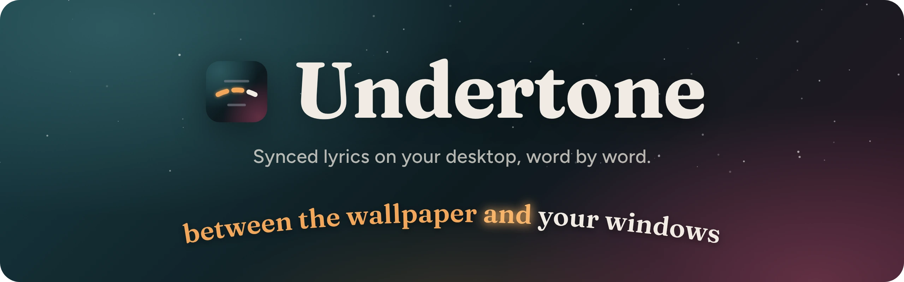

  
  
  
  
  

  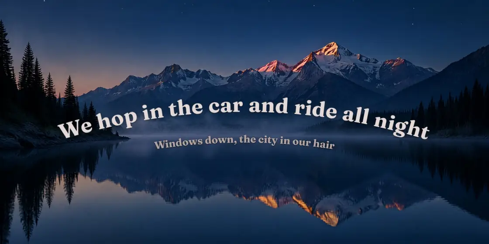

## Download

  <a href="https://github.com/sussyswimmer/lyricsync/releases/latest/download/Undertone_universal.dmg">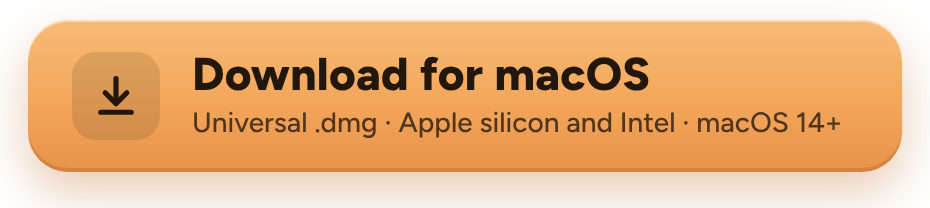</a>
  &nbsp;
  <a href="https://github.com/sussyswimmer/lyricsync/releases/latest/download/Undertone_x64-setup.exe">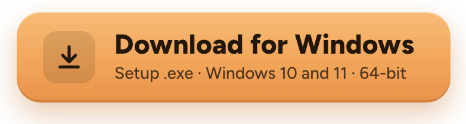</a>

Free. Works with Spotify and Apple Music on a Mac, and any player in the Windows media controls.

> [!NOTE]
> Early release, not code-signed yet. The first time, on a Mac click **Open Anyway** in **System Settings → Privacy & Security**; on Windows click **More info**, then **Run anyway**. [Install help](docs/INSTALL.md)

## A look for every song

<table>
  <tr>
    <td width="33%" align="center">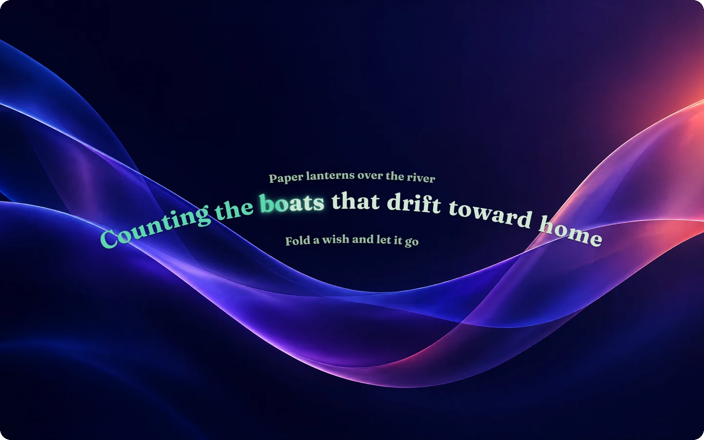 <b>Arc</b></td>
    <td width="33%" align="center">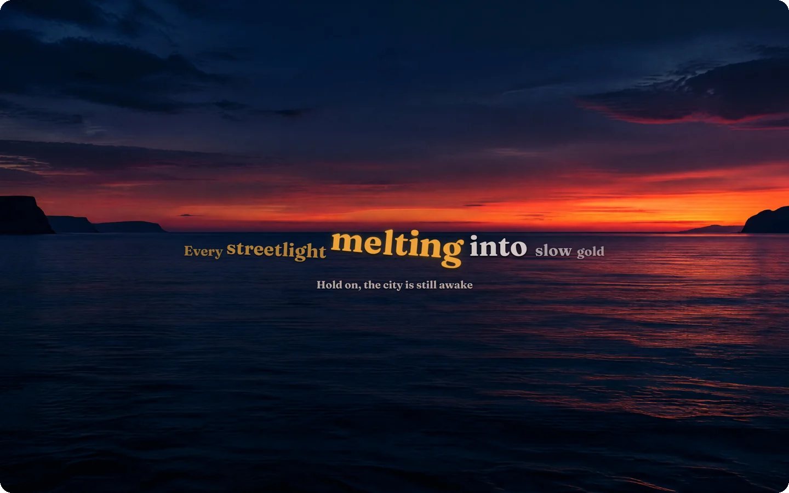 <b>Lens</b></td>
    <td width="33%" align="center">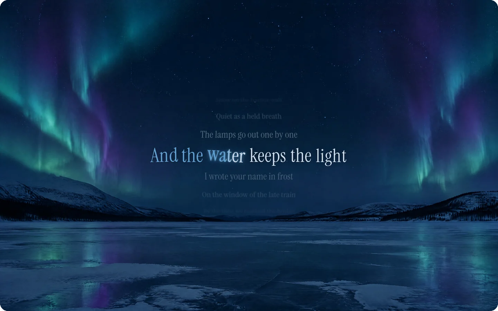 <b>Drift</b></td>
  </tr>
  <tr>
    <td width="33%" align="center">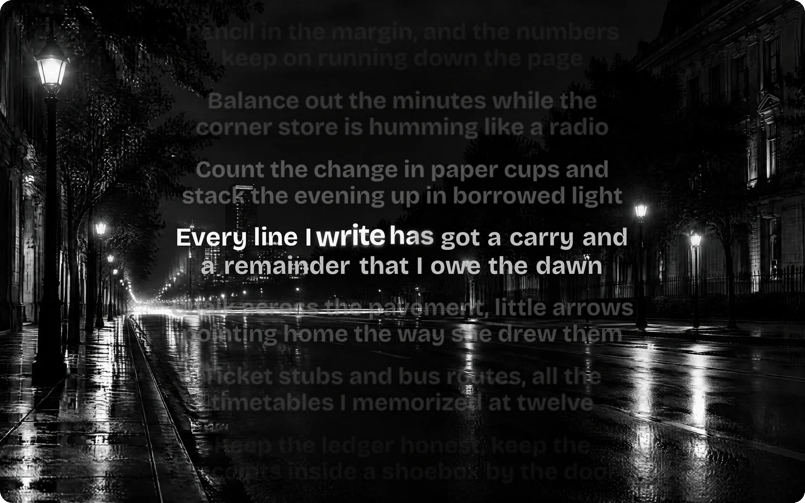 <b>Stack</b></td>
    <td width="33%" align="center">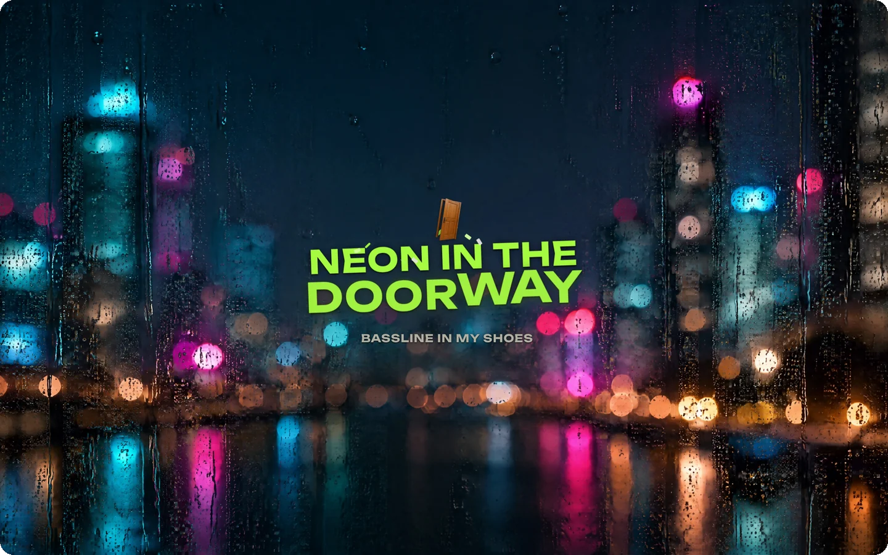 <b>Poster</b></td>
    <td width="33%" align="center">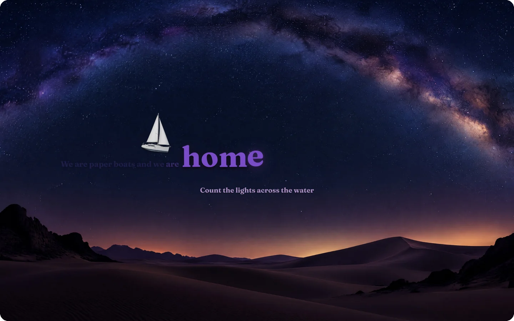 <b>Spotlight</b></td>
  </tr>
  <tr>
    <td width="33%" align="center">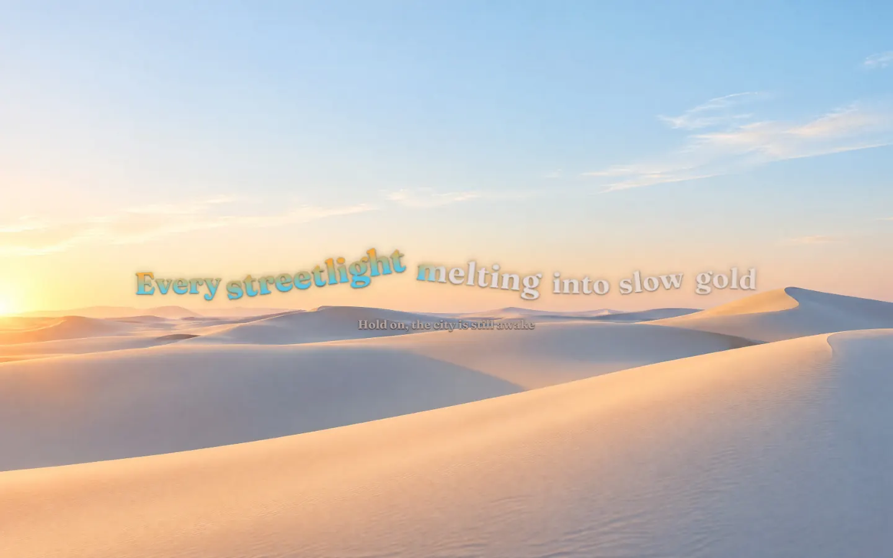 <b>Wave</b></td>
    <td width="33%" align="center">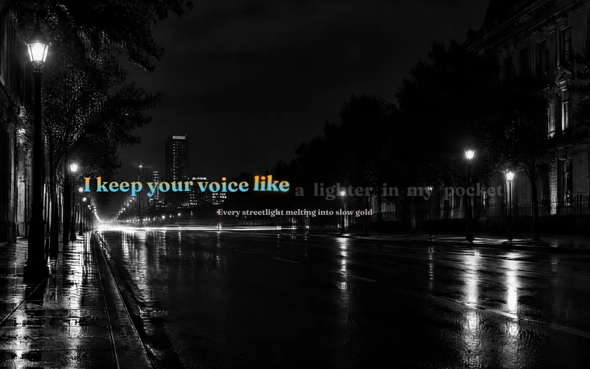 <b>Reveal</b></td>
    <td width="33%" align="center">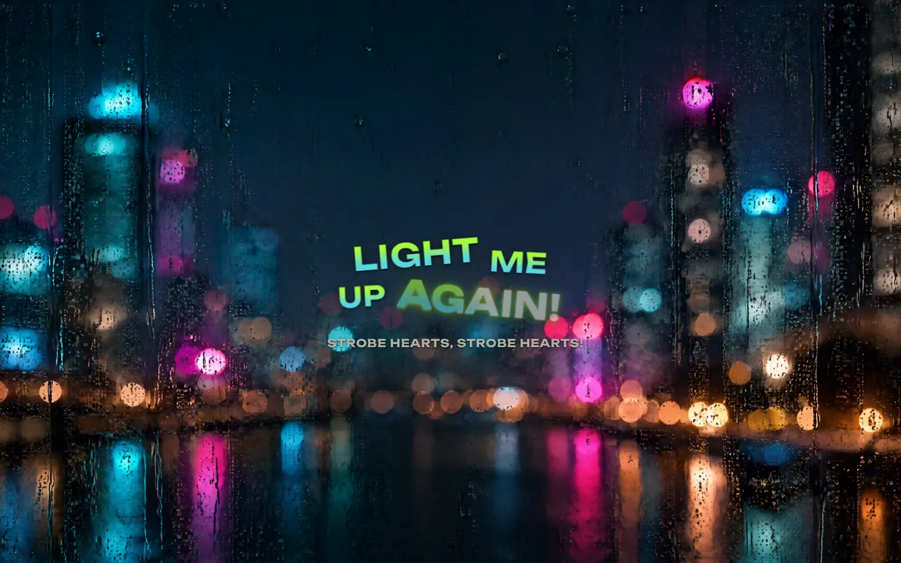 <b>Collage</b></td>
  </tr>
</table>

Undertone picks the layout, one of 15 fonts and the motion from the song, and the colors from its cover. Words you can picture come to life in the line, and the words around them move with them.

## Words you can picture

  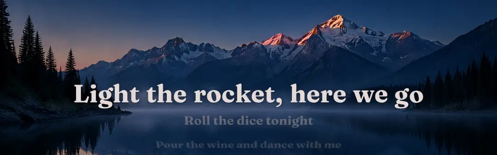

All 140 pictures

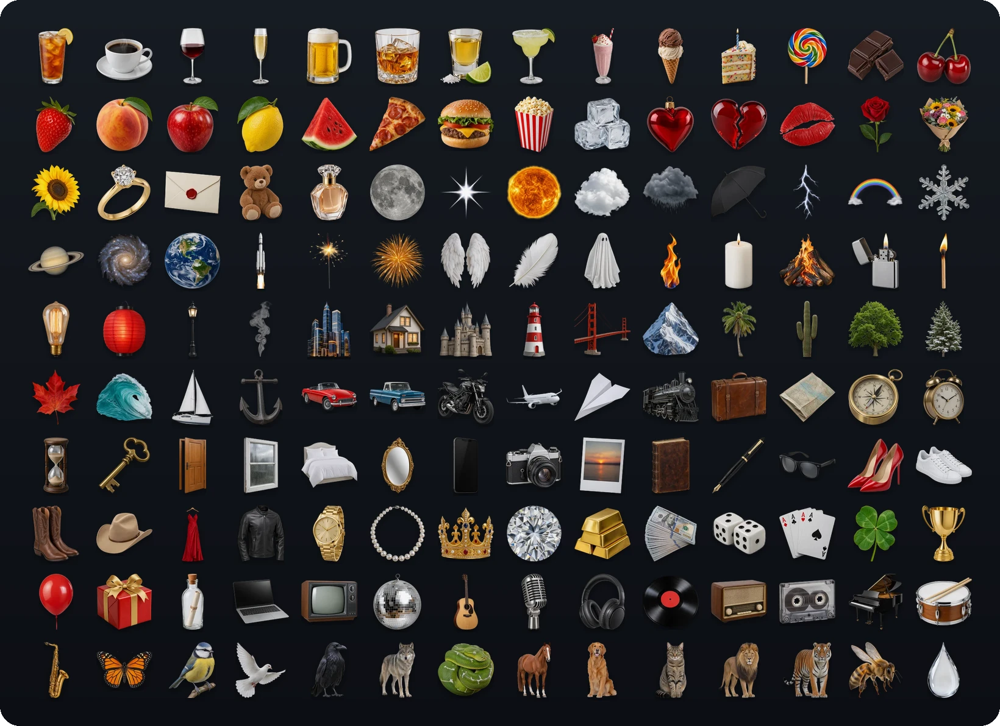

## How it's built

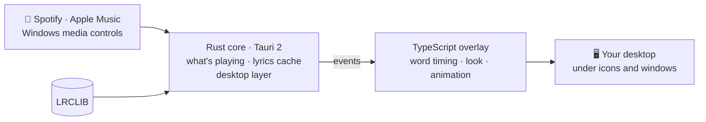

- **Rust** reads what's playing, fetches lyrics from [LRCLIB](https://lrclib.net) and pins the overlay under your desktop icons.
- **TypeScript** times every word, picks a look from the song and its cover, and animates it on the GPU.

## Docs

[User guide](docs/USER_GUIDE.md) · [Install](docs/INSTALL.md) · [Troubleshooting](docs/TROUBLESHOOTING.md) · [Development](docs/DEVELOPMENT.md) · [Architecture](SPEC.md)

Lyrics from LRCLIB. Word pictures and wallpapers made for Undertone with Higgsfield. Fonts under the SIL Open Font License.
