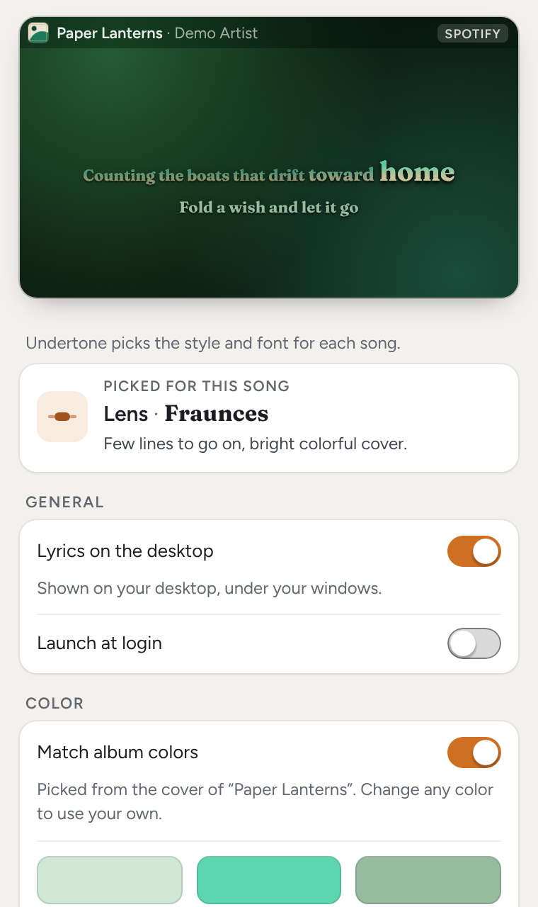
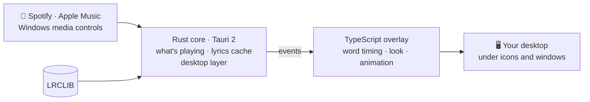

<p align="center">
  
</p>

<p align="center">
  <a href="https://github.com/sussyswimmer/lyricsync/releases/latest"></a>
  <a href="https://github.com/sussyswimmer/lyricsync/releases"></a>
  <a href="https://github.com/sussyswimmer/lyricsync/actions/workflows/ci.yml"></a>
  <a href="LICENSE"></a>
  
  
  
</p>

<p align="center">
  <b>Synced lyrics on your desktop, word by word, for whatever you're playing.</b><br>
  A look picked for every song, colors from its cover, and pictures that join in. Free and open source.
</p>

<p align="center">
  <a href="https://github.com/sussyswimmer/lyricsync/releases/latest/download/Undertone_universal.dmg"></a>
  &nbsp;
  <a href="https://github.com/sussyswimmer/lyricsync/releases/latest/download/Undertone_x64-setup.exe"></a>
</p>

<p align="center">
  <sub>
    macOS 14 or later, one build for Apple silicon and Intel ·
    Windows 10 and 11, x64 ·
    <a href="https://github.com/sussyswimmer/lyricsync/releases">all releases</a>
  </sub>
</p>

<p align="center">
  
</p>

## Features

<table>
  <tr>
    <td width="50%" valign="top">
      <b>🎤 Word by word, at the song's pace</b><br>
      Words fill with color syllable by syllable as they're sung, and a held note keeps its word lit. Turn on <b>Karaoke mode</b> for a dot that bounces onto each word as you should sing it.
    </td>
    <td width="50%" valign="top">
      <b>🎨 A look for every song</b><br>
      Undertone picks one of six styles and one of eight fonts from how the song is sung, and the colors from its cover.
    </td>
  </tr>
  <tr>
    <td width="50%" valign="top">
      <b>🐦 Words you can picture</b><br>
      With <b>Effects mode</b> on, 140 pictures join the song as their words are sung: birds fly, cars drive along the words, rain falls, fireworks burst.
    </td>
    <td width="50%" valign="top">
      <b>🖱️ Under your windows, out of your way</b><br>
      The lyrics sit on the desktop, above the wallpaper and below your icons. Windows cover them, clicks go straight through, and there's no Dock icon.
    </td>
  </tr>
  <tr>
    <td width="50%" valign="top">
      <b>🎧 Spotify and Apple Music</b><br>
      Spotify on macOS and Windows, the Music app on macOS, and on Windows any player that shows up in the media controls.
    </td>
    <td width="50%" valign="top">
      <b>🪶 Light and private</b><br>
      No account, no API key, no telemetry. It talks only to the lyrics database, and moves to a lighter mode on computers without graphics acceleration.
    </td>
  </tr>
</table>

## A look for every song

<table>
  <tr>
    <td width="33%" valign="top"><br><b>Arc</b> · The line runs along a gentle curve, with the lines before and after above and below.</td>
    <td width="33%" valign="top"><br><b>Lens</b> · One line at a time; the word being sung is magnified as if under a lens.</td>
    <td width="33%" valign="top"><br><b>Drift</b> · The song scrolls up line by line, its neighbors tilted back in 3D.</td>
  </tr>
  <tr>
    <td width="33%" valign="top"><br><b>Stack</b> · The same scrolling list, flat, like a lyrics sheet.</td>
    <td width="33%" valign="top"><br><b>Poster</b> · Each line set like a gig poster, its words punching up as they're sung.</td>
    <td width="33%" valign="top"><br><b>Spotlight</b> · The word being sung is huge in the middle; the rest fall away to either side.</td>
  </tr>
</table>

Undertone picks the style, font and motion from the song itself (how fast and densely it's sung, held notes, repeated and shouted lines, words in the title) and the colors from its cover. The same song always gets the same look. [The user guide](docs/USER_GUIDE.md#look) explains how it chooses.

## Words you can picture

<p align="center">
  
</p>

The pictures, each song's own motion and its splashes come with **Effects mode**, which starts off: turn it on in **Settings › Look** or from the menu.

<details>
<summary>All 140 pictures</summary>
<p align="center"></p>
</details>

## Settings

Settings follows your system's light or dark mode, and every change applies at once. The live preview at the top plays the current song with your settings, and the card under it names the look picked for that song and why.

<p align="center">
  <picture>
    <source media="(prefers-color-scheme: dark)" srcset="docs/media/settings-dark.png">
    <source media="(prefers-color-scheme: light)" srcset="docs/media/settings-light.png">
    
  </picture>
</p>

[docs/USER_GUIDE.md](docs/USER_GUIDE.md) explains every setting in plain words.

## Install

> **Status: early release.** Not every check in [docs/ACCEPTANCE.md](docs/ACCEPTANCE.md) has been run on a real Mac and PC yet, so expect rough edges, and please [report what you find](https://github.com/sussyswimmer/lyricsync/issues/new?template=bug_report.yml).

1. **Download** [`Undertone_universal.dmg`](https://github.com/sussyswimmer/lyricsync/releases/latest/download/Undertone_universal.dmg) for macOS or [`Undertone_x64-setup.exe`](https://github.com/sussyswimmer/lyricsync/releases/latest/download/Undertone_x64-setup.exe) for Windows from the [latest release](https://github.com/sussyswimmer/lyricsync/releases/latest).
2. **Open it.** The builds aren't code-signed yet, so your system warns you the first time.
   - **macOS:** drag Undertone into Applications and open it, then click **Open Anyway** in **System Settings → Privacy & Security**. The first time Undertone reads Spotify or Music, macOS asks whether it may; click **OK** ([why](docs/INSTALL.md#macos-automation)).
   - **Windows:** if SmartScreen says *Windows protected your PC*, click **More info**, then **Run anyway**.
3. **Play a song** in Spotify or Music. The lyrics appear on your desktop.

**[docs/INSTALL.md](docs/INSTALL.md)** has the full steps for each macOS version and Windows, the fix for "Undertone is damaged", WebView2, updating and uninstalling.

Undertone lives in the menu bar (macOS) or the system tray (Windows). The first time, the settings window opens too; after that, choose **Settings…** from the icon. The same menu hides the lyrics, sets how much the words move, nudges the sync and refetches lyrics ([the whole menu](docs/USER_GUIDE.md#menu-and-shortcuts)). These shortcuts work from any app; they're the defaults, and you can change or turn them off in **Settings › Shortcuts**:

| macOS | Windows | What it does |
|---|---|---|
| ⌥⇧⌘L | Ctrl+Alt+Shift+L | Show or hide the lyrics |
| ⌥⇧⌘[ | Ctrl+Alt+Shift+[ | Nudge this song 50 ms later |
| ⌥⇧⌘] | Ctrl+Alt+Shift+] | Nudge this song 50 ms earlier |

## How it works

Undertone asks the player what's playing: Spotify and Music through Apple Events on macOS, the system media session on Windows.<br>
It looks the song up on LRCLIB by title, artist, album and length, and keeps the lyrics on your computer for next time.<br>
From the lyrics, their timing and the cover, it picks a look for the song, then times every word at the pace it's sung.<br>
The words are animated on the GPU in a click-through window pinned to the desktop, above the wallpaper and below your icons and windows.



The Rust core talks to the player, the network and the desktop; the TypeScript frontend does everything about time, color and drawing. [SPEC.md](SPEC.md) has the architecture.

## Privacy

Anything that reads what you're playing should say exactly what it does with it:

- Undertone only reads what's playing: the title, artist, album, length, position, play state and cover art. It never plays, pauses or skips anything, and it never starts a player by itself.
- To find lyrics, it sends the title, artist, album and length to [LRCLIB](https://lrclib.net). For Spotify on macOS, it also downloads the cover art from Spotify's image server. Nothing else leaves your computer.
- No account, no API key, no telemetry and no analytics.
- Lyrics are cached on your computer, never bundled with the app. Its log and `--diagnose` reports never contain lyric text.

On a Mac, Undertone needs one permission: macOS asks whether it may read Spotify and Music (Automation). On Windows there's nothing to grant. [Permissions](docs/INSTALL.md#permissions) explains why, and how to turn it back on if you clicked **Don't Allow**.

## FAQ

<details>
<summary><b>Which music apps work?</b></summary>

On macOS 14 or later, the Spotify app and the Music app (Apple Music), but not players in a web browser. On Windows 10 and 11, Spotify and any other player that shows up in the Windows media controls next to the volume slider. When several are playing, Undertone prefers Spotify.

</details>

<details>
<summary><b>Can I pick the style myself?</b></summary>

Not in this version. Undertone picks the style and font for each song from how it's sung, and the same song always gets the same look. You can still set the size, how much the lyrics move and glow, and the colors, turn each song's extra effects (its own motion, splashes and pictures) on with **Effects mode**, and add a dot that bounces from word to word with **Karaoke mode**. Both start off. See [Look](docs/USER_GUIDE.md#look) in the user guide.

</details>

<details>
<summary><b>Where do the lyrics come from?</b></summary>

From [LRCLIB](https://lrclib.net), a free lyrics database the community builds. Undertone looks each song up when it starts playing and keeps the lyrics on your computer, so the song loads instantly next time. No lyrics ship with the app.

When LRCLIB has nothing for a song, a small "No lyrics for this song" note shows for a few seconds. **Refetch lyrics** in the menu asks again, and [lrclib.net](https://lrclib.net) explains how to add or correct lyrics. More in [No lyrics, or the wrong song](docs/TROUBLESHOOTING.md#no-lyrics-or-the-wrong-song).

</details>

<details>
<summary><b>The lyrics are early or late. How do I fix it?</b></summary>

If every song is off by about the same amount (Bluetooth headphones add a delay, for example), move the **All songs** slider in **Settings › Sync**. If one song is off, nudge just that one: **Sync ▸ Earlier/Later 100 ms** in the menu, the 50 ms shortcuts above, or the buttons under **This song** in Settings. Undertone remembers each song's nudge. See [Lyrics are early or late](docs/TROUBLESHOOTING.md#lyrics-are-early-or-late).

</details>

<details>
<summary><b>I don't see any lyrics. What's wrong?</b></summary>

Usually one of these: the song is paused (by default, lyrics only show while music plays), the lyrics are switched off (⌥⇧⌘L or Ctrl+Alt+Shift+L brings them back), a window is covering the desktop, or the player isn't one Undertone can read. On a Mac, check that Undertone may read the player ([Permissions](docs/INSTALL.md#permissions)). [Nothing shows up](docs/TROUBLESHOOTING.md#nothing-shows-up) walks through each one.

</details>

<details>
<summary><b>Will it slow down my computer?</b></summary>

It's built not to. The lines are laid out once and their motion is handed to the GPU, and on a computer without graphics acceleration Undertone moves to a lighter mode. When you pause, hide the lyrics or quit the player, it stops animating. If you've asked your system to reduce motion, the lyrics stay still and lines change with a short crossfade.

</details>

<details>
<summary><b>Why does my Mac or PC warn me when I open it?</b></summary>

The builds aren't signed with an Apple or Microsoft developer certificate yet, so both systems ask you to confirm the first time. [docs/INSTALL.md](docs/INSTALL.md) shows how, for each macOS version and for Windows. Only do this for a copy you downloaded from this project's Releases or Actions pages.

</details>

<details>
<summary><b>How do I update or uninstall?</b></summary>

To update, quit Undertone and install the new version over the old one; your settings, sync nudges and cached lyrics are kept. If a new feature doesn't show up, see [A feature is missing after an update](docs/TROUBLESHOOTING.md#a-feature-is-missing-after-an-update).

To uninstall on macOS, turn off **Launch at login** in Undertone's menu, quit it, and drag it from Applications to the Trash. On Windows, quit Undertone, then uninstall it from **Settings → Apps → Installed apps**. [Uninstalling](docs/INSTALL.md#uninstalling) shows where your settings, cached lyrics and log live, if you want those gone too.

</details>

<details>
<summary><b>How do I report a bug?</b></summary>

Run Undertone with `--diagnose`: it saves a report of what it sees right now (players, the current song, the lyrics match, settings and displays, never lyric text). Attach that file to a [bug report](https://github.com/sussyswimmer/lyricsync/issues/new?template=bug_report.yml). [Reporting a bug](docs/TROUBLESHOOTING.md#reporting-a-bug) has the exact command for each OS and where the log lives.

For a security problem, please follow [SECURITY.md](SECURITY.md) instead of opening an issue.

</details>

More answers in [docs/TROUBLESHOOTING.md](docs/TROUBLESHOOTING.md).

## Build from source

You need Node 24+, pnpm 11, Rust stable and the [Tauri prerequisites](https://v2.tauri.app/start/prerequisites/) for your OS (WebView2 and MSVC on Windows, the Xcode command line tools on macOS).

```sh
git clone https://github.com/sussyswimmer/lyricsync.git
cd lyricsync
pnpm install --frozen-lockfile
pnpm tauri dev
```

No Mac or PC at hand? `pnpm dev` runs both pages in a plain browser at <http://localhost:1420>, against a mock player with ten demo songs. [docs/DEVELOPMENT.md](docs/DEVELOPMENT.md) has the checks CI runs, the mock's keys and URL parameters, the debug flags and the project layout.

## Roadmap

- [x] **The first release,** 0.1.0, on GitHub Releases.
- [ ] **Checked on real machines:** every step of [docs/ACCEPTANCE.md](docs/ACCEPTANCE.md) on a Mac and a PC.
- [ ] **Signed builds,** so macOS and Windows open Undertone without a warning.
- [ ] **Automatic proxy settings** (PAC scripts and WPAD). Proxies set by hand already work.
- [ ] **macOS: spotting clashes with system shortcuts** in **Settings › Shortcuts**.

Not planned for v1: the lock screen, Linux, mobile and playback controls. Have another idea? [Suggest a feature](https://github.com/sussyswimmer/lyricsync/issues/new?template=feature_request.yml).

## Contributing

Bug reports, ideas and pull requests are all welcome. Undertone is split into a Rust core (now playing, lyrics, settings, the tray and the desktop layer) and a TypeScript frontend (word timing, the look for each song, the animation and the settings window), which meet at a small typed contract. [CONTRIBUTING.md](CONTRIBUTING.md) explains how commits and pull requests work and how to send a diagnostics report, and [docs/DEVELOPMENT.md](docs/DEVELOPMENT.md) how to build and test. Everyone who takes part agrees to the [Code of Conduct](CODE_OF_CONDUCT.md).

**Docs:** [User guide](docs/USER_GUIDE.md) · [Install](docs/INSTALL.md) · [Troubleshooting](docs/TROUBLESHOOTING.md) · [Development](docs/DEVELOPMENT.md) · [Architecture](SPEC.md) · [Changelog](CHANGELOG.md)

## Credits

Lyrics come from [LRCLIB](https://lrclib.net). Word pictures and wallpapers were made for Undertone with Higgsfield. Undertone is built on these open-source projects:

- [Tauri](https://tauri.app): the app shell, its windows, tray, shortcuts and installers
- [windows-rs](https://github.com/microsoft/windows-rs): the Windows media session and desktop layer
- [objc2](https://github.com/madsmtm/objc2): Apple Events and AppKit on macOS
- [reqwest](https://github.com/seanmonstar/reqwest) and [Tokio](https://tokio.rs): the lyrics lookup
- [image](https://github.com/image-rs/image): cover art
- [Vite](https://vite.dev) and [Vitest](https://vitest.dev): the frontend build and tests

The lyric fonts (Fraunces, Instrument Serif, Syne, Unbounded, Bricolage Grotesque, Caveat and JetBrains Mono) and the settings window's font, Figtree, come through [Fontsource](https://fontsource.org) under the SIL Open Font License 1.1. **Settings › Licenses** shows the notices of every font and library Undertone includes, and `THIRD_PARTY_NOTICES.txt` next to the app holds the same text.

## License

Undertone is released under the [MIT License](LICENSE). © 2026 [Maxwell Olander](https://maxwellolander.com).
