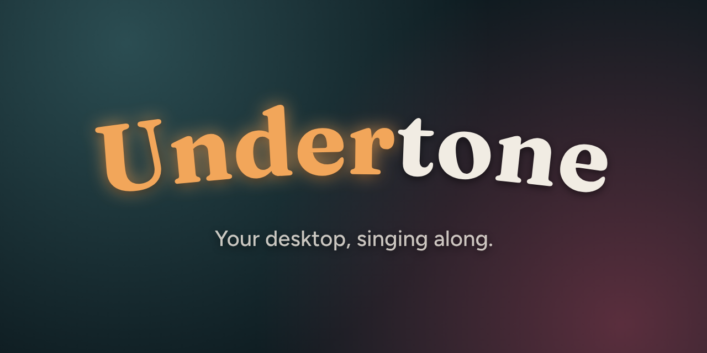
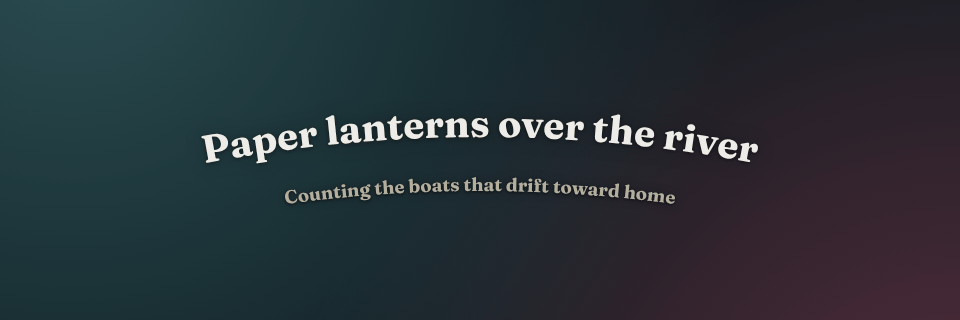
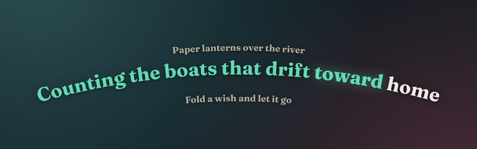
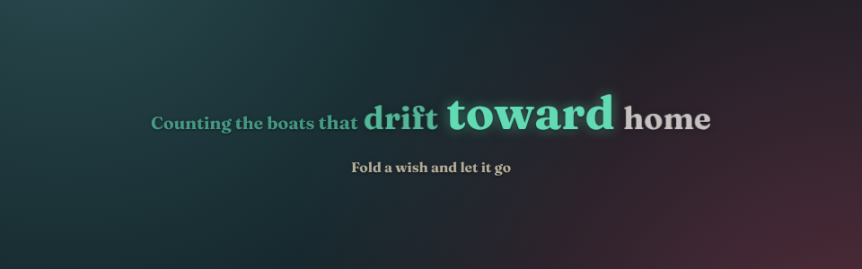
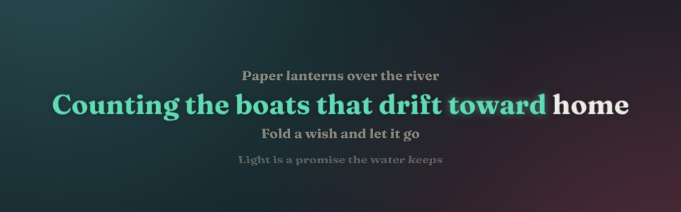
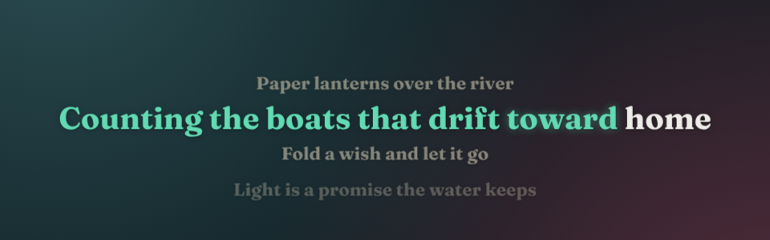
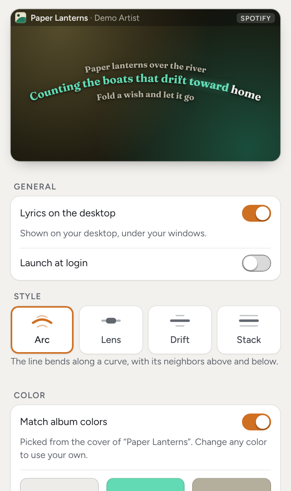
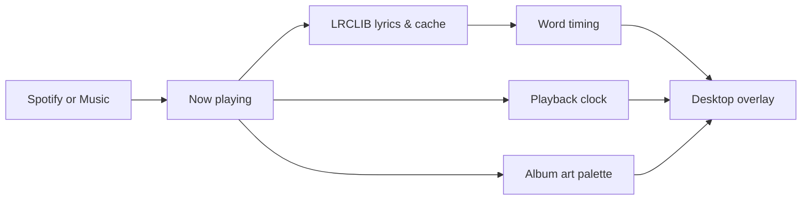

<p align="center">
  
</p>

<p align="center">
  <a href="https://github.com/sussyswimmer/lyricsync/releases/latest"></a>
  <a href="https://github.com/sussyswimmer/lyricsync/releases"></a>
  <a href="https://github.com/sussyswimmer/lyricsync/actions/workflows/ci.yml"></a>
  <a href="LICENSE"></a>
  
  
  
</p>

<p align="center">
  <b>Synced lyrics on your desktop for whatever you're playing.</b><br>
  Words light up as they're sung, in colors from the album art. Free and open source.
</p>

<p align="center">
  <a href="https://github.com/sussyswimmer/lyricsync/releases/latest">
    
  </a>
  &nbsp;
  <a href="https://github.com/sussyswimmer/lyricsync/releases/latest">
    
  </a>
</p>

<p align="center">
  <sub>
    macOS 14 or later, one build for Apple silicon and Intel ·
    Windows 10 and 11, x64 ·
    <a href="https://github.com/sussyswimmer/lyricsync/releases">all releases</a>
  </sub><br>
  <sub><b>Pre-release:</b> nothing is published yet, so for now take a test build from CI, as <a href="docs/INSTALL.md#download">docs/INSTALL.md</a> explains.</sub>
</p>

<p align="center">
  
</p>
<p align="center"><sub>The real renderer playing one of its built-in demo songs (original placeholder lyrics) over a stand-in wallpaper.</sub></p>

## Features

<table>
  <tr>
    <td width="50%" valign="top">
      <b>🎤 Word-by-word sync</b><br>
      Words light up as they're sung. Lyrics timed word by word are followed exactly; for the rest, Undertone estimates each word from its syllables. Off by a beat? Nudge one song or all of them.
    </td>
    <td width="50%" valign="top">
      <b>🎨 Album-art colors</b><br>
      The text and highlight colors come from the cover of whatever's playing, tuned to stay readable on any wallpaper. Or pick your own.
    </td>
  </tr>
  <tr>
    <td width="50%" valign="top">
      <b>🖱️ Under your windows, out of your way</b><br>
      The lyrics sit on the desktop, above the wallpaper and below your icons. Windows cover them, clicks go straight through, and there's no Dock icon.
    </td>
    <td width="50%" valign="top">
      <b>✨ Four styles</b><br>
      Arc, Lens, Drift and Stack, in seven bundled fonts or your system's, with your own size, curve, height, glow and opacity.
    </td>
  </tr>
  <tr>
    <td width="50%" valign="top">
      <b>🎧 Spotify and Apple Music</b><br>
      Spotify on macOS and Windows, the Music app on macOS, and on Windows any player that shows up in the media controls.
    </td>
    <td width="50%" valign="top">
      <b>🪶 Light and private</b><br>
      No account, no API key, no telemetry. It animates only while music plays, and talks only to the lyrics database.
    </td>
  </tr>
</table>

## Styles

<table>
  <tr>
    <td width="50%" valign="top">
      <br>
      <b>Arc</b> · The line bends along a curve, with its neighbors above and below.
    </td>
    <td width="50%" valign="top">
      <br>
      <b>Lens</b> · One line at a time; the word being sung swells as if under a lens.
    </td>
  </tr>
  <tr>
    <td width="50%" valign="top">
      <br>
      <b>Drift</b> · The song scrolls up line by line, neighbors fading back into depth.
    </td>
    <td width="50%" valign="top">
      <br>
      <b>Stack</b> · The song scrolls up line by line, flat, like a lyrics sheet.
    </td>
  </tr>
</table>

## Settings

Settings follows your system's light or dark mode, and every change applies at once, on the desktop and in the live preview at the top, which plays the current song with your settings.

<p align="center">
  <picture>
    <source media="(prefers-color-scheme: dark)" srcset="assets/settings-dark.png">
    <source media="(prefers-color-scheme: light)" srcset="assets/settings-light.png">
    
  </picture>
</p>

[docs/USER_GUIDE.md](docs/USER_GUIDE.md) explains every setting in plain words.

## Install

> **Status: pre-release.** Every part of v1 is built. A first run on a real Mac (macOS 26, Spotify) showed the song, cover art and lyrics arriving and the overlay sitting on the desktop. The rest of the Mac checks, Apple Music and Windows haven't been run yet, so expect rough edges. Progress is logged in [docs/HANDOFF.md](docs/HANDOFF.md).

1. **Download** the `.dmg` for macOS or the `-setup.exe` for Windows from the [latest release](https://github.com/sussyswimmer/lyricsync/releases/latest). Until the first release is out, take a test build from a CI run, as [docs/INSTALL.md](docs/INSTALL.md#download) explains.
2. **Open it.** The builds aren't code-signed yet, so your system warns you the first time.
   - **macOS:** drag Undertone into Applications and open it, then click **Open Anyway** in **System Settings → Privacy & Security**. The first time Undertone reads Spotify or Music, macOS asks whether it may; click **OK** ([why](#macos-automation)).
   - **Windows:** if SmartScreen says *Windows protected your PC*, click **More info**, then **Run anyway**.
3. **Play a song** in Spotify or Music. The lyrics appear on your desktop.

**[docs/INSTALL.md](docs/INSTALL.md)** has the full steps for each macOS version and Windows, the fix for "Undertone is damaged", WebView2, updating and uninstalling.

Undertone lives in the menu bar (macOS) or the system tray (Windows). The first time, the settings window opens too; after that, choose **Settings…** from the icon. The same menu hides the lyrics, switches the style, nudges the sync and refetches lyrics ([the whole menu](docs/USER_GUIDE.md#menu-and-shortcuts)). These shortcuts work from any app; they're the defaults, and you can change or turn them off in **Settings › Shortcuts**:

| macOS | Windows | What it does |
|---|---|---|
| ⌥⇧⌘L | Ctrl+Alt+Shift+L | Show or hide the lyrics |
| ⌥⇧⌘[ | Ctrl+Alt+Shift+[ | Nudge this song 50 ms later |
| ⌥⇧⌘] | Ctrl+Alt+Shift+] | Nudge this song 50 ms earlier |

## How it works

Undertone asks the player what's playing: Spotify and Music through Apple Events on macOS, the system media session on Windows.<br>
It looks the song up on LRCLIB by title, artist, album and length, and keeps the lyrics on your computer for next time.<br>
A playback clock follows the player's position, words without their own timestamps get one estimated from their syllables, and the colors come from the cover.<br>
The lyrics are drawn in a click-through window pinned to the desktop, above the wallpaper and below your icons and windows.



The Rust core talks to the player, the network and the desktop; the TypeScript frontend does everything about time, color and drawing. [SPEC.md](SPEC.md) has the architecture.

## Privacy and permissions

Anything that reads what you're playing should say exactly what it does with it:

- Undertone only reads what's playing: the title, artist, album, length, position, play state and cover art. It never plays, pauses or skips anything, and it never starts a player by itself.
- To find lyrics, it sends the title, artist, album and length to [LRCLIB](https://lrclib.net). For Spotify on macOS, it also downloads the cover art from Spotify's image server. Nothing else leaves your computer.
- No account, no API key, no telemetry and no analytics.
- Lyrics are cached on your computer, never bundled with the app. Its log and `--diagnose` reports never contain lyric text.

### macOS: Automation

The first time Undertone reads Spotify or Music, macOS asks whether **Undertone** may control **Spotify** (or **Music**). Click **OK**.

- **Why it's needed:** macOS has no public way for an app to see what another app is playing. Undertone asks Spotify and Music directly, through Apple Events, for the title, artist, album, length, position, play state and cover art. It only reads. It never starts, pauses or skips anything, and it checks that the player is already running before asking, so it never launches Spotify or Music by itself.
- **If you click Don't Allow:** Undertone can't see what that app is playing, so you get no lyrics for it. While that app is open, the settings window says so at the top ("Undertone can't see what Spotify is playing.") and names the switch to turn on. Nothing else breaks.
- **To turn it back on:** open **System Settings → Privacy & Security → Automation**, find **Undertone**, and switch on **Spotify** and/or **Music**. Undertone notices within about 5 seconds, without a restart, and the notice in Settings goes away. If Undertone or the player is missing from that list, or switching it on doesn't help, reset Undertone's Automation permission in Terminal with `tccutil reset AppleEvents com.undertone.desktop`, quit and reopen Undertone, and play a song to get the prompt again.

macOS asks once per player, so you may see the prompt a second time when you first use the other app.

### Windows

Nothing to grant. Undertone reads the system media session, the same information Windows shows in its media controls next to the volume slider. When several apps are playing, it prefers Spotify.

## FAQ

<details>
<summary><b>Which music apps work?</b></summary>

On macOS 14 or later, the Spotify app and the Music app (Apple Music), but not players in a web browser. On Windows 10 and 11, Spotify and any other player that shows up in the Windows media controls next to the volume slider. When several are playing, Undertone prefers Spotify.

</details>

<details>
<summary><b>Where do the lyrics come from?</b></summary>

From [LRCLIB](https://lrclib.net), a free lyrics database the community builds. Undertone looks each song up when it starts playing and keeps the lyrics on your computer, so the song loads instantly next time. No lyrics ship with the app.

When LRCLIB has nothing for a song, a small "No lyrics for this song" note shows for a few seconds. **Refetch lyrics** in the menu asks again, and [lrclib.net](https://lrclib.net) explains how to add or correct lyrics. More in [No lyrics, or the wrong song](docs/TROUBLESHOOTING.md#no-lyrics-or-the-wrong-song).

</details>

<details>
<summary><b>The lyrics are early or late. How do I fix it?</b></summary>

If every song is off by about the same amount (Bluetooth headphones add a delay, for example), move the **All songs** slider in **Settings › Sync**. If one song is off, nudge just that one: **Sync ▸ Earlier/Later 100 ms** in the menu, the 50 ms shortcuts above, or the buttons under **This song** in Settings. Undertone remembers each song's nudge. See [Lyrics are early or late](docs/TROUBLESHOOTING.md#lyrics-are-early-or-late).

</details>

<details>
<summary><b>I don't see any lyrics. What's wrong?</b></summary>

Usually one of these: the song is paused (by default, lyrics only show while music plays), the lyrics are switched off (⌥⇧⌘L or Ctrl+Alt+Shift+L brings them back), a window is covering the desktop, or the player isn't one Undertone can read. On a Mac, check that Undertone may read the player ([macOS: Automation](#macos-automation)). [Nothing shows up](docs/TROUBLESHOOTING.md#nothing-shows-up) walks through each one.

</details>

<details>
<summary><b>Will it slow down my computer?</b></summary>

It's built not to. Undertone draws each line once and then only changes colors and positions, and it animates only while a song plays and the lyrics are on screen. When you pause, hide the lyrics or quit the player, it stops animating. If you've asked your system to reduce motion, the lyrics stay still and lines change with a short crossfade.

</details>

<details>
<summary><b>Why does my Mac or PC warn me when I open it?</b></summary>

The builds aren't signed with an Apple or Microsoft developer certificate yet, so both systems ask you to confirm the first time. [docs/INSTALL.md](docs/INSTALL.md) shows how, for each macOS version and for Windows. Only do this for a copy you downloaded from this project's Releases or Actions pages.

</details>

<details>
<summary><b>How do I uninstall?</b></summary>

On macOS, turn off **Launch at login** in Undertone's menu, quit it, and drag it from Applications to the Trash. On Windows, quit Undertone, then uninstall it from **Settings → Apps → Installed apps**. [Uninstalling](docs/INSTALL.md#uninstalling) shows where your settings, cached lyrics and log live, if you want those gone too.

</details>

<details>
<summary><b>How do I report a bug?</b></summary>

Run Undertone with `--diagnose`: it saves a report of what it sees right now (players, the current song, the lyrics match, settings and displays, never lyric text). Attach that file to a [bug report](https://github.com/sussyswimmer/lyricsync/issues/new?template=bug_report.yml). [Reporting a bug](docs/TROUBLESHOOTING.md#reporting-a-bug) has the exact command for each OS and where the log lives.

For a security problem, please follow [SECURITY.md](SECURITY.md) instead of opening an issue.

</details>

More answers in [docs/TROUBLESHOOTING.md](docs/TROUBLESHOOTING.md).

## Build from source

You need Node 24+, pnpm 11, Rust stable and the [Tauri prerequisites](https://v2.tauri.app/start/prerequisites/) for your OS (WebView2 and MSVC on Windows, the Xcode command line tools on macOS).

```sh
git clone https://github.com/sussyswimmer/lyricsync.git
cd lyricsync
pnpm install --frozen-lockfile
pnpm tauri dev
```

No Mac or PC at hand? `pnpm dev` runs both pages in a plain browser at <http://localhost:1420>, against a mock player with six demo songs. [CONTRIBUTING.md](CONTRIBUTING.md#development) has the checks CI runs, the mock's keys and URL parameters, the debug flags and the project layout.

## Roadmap

- [ ] **The first release** on GitHub Releases, once the checks in [docs/ACCEPTANCE.md](docs/ACCEPTANCE.md) pass on a real Mac and PC.
- [ ] **Signed builds,** so macOS and Windows open Undertone without a warning.
- [ ] **Automatic proxy settings** (PAC scripts and WPAD). Proxies set by hand already work.
- [ ] **macOS: spotting clashes with system shortcuts** in **Settings › Shortcuts**.

Not planned for v1: the lock screen, Linux, mobile and playback controls. Have another idea? [Suggest a feature](https://github.com/sussyswimmer/lyricsync/issues/new?template=feature_request.yml).

## Contributing

Bug reports, ideas and pull requests are all welcome. Undertone is split into a Rust core (now playing, lyrics, settings, the tray and the desktop layer) and a TypeScript frontend (the lyric renderer, the settings window, word timing, the playback clock and colors), which meet at a small typed contract. [CONTRIBUTING.md](CONTRIBUTING.md) explains the layout, the checks, how commits and pull requests work, and how to send a diagnostics report. Everyone who takes part agrees to the [Code of Conduct](CODE_OF_CONDUCT.md).

## Credits

Lyrics come from [LRCLIB](https://lrclib.net). Undertone is built on these open-source projects:

- [Tauri](https://tauri.app): the app shell, its windows, tray, shortcuts and installers
- [windows-rs](https://github.com/microsoft/windows-rs): the Windows media session and desktop layer
- [objc2](https://github.com/madsmtm/objc2): Apple Events and AppKit on macOS
- [reqwest](https://github.com/seanmonstar/reqwest) and [Tokio](https://tokio.rs): the lyrics lookup
- [image](https://github.com/image-rs/image): cover art
- [Vite](https://vite.dev) and [Vitest](https://vitest.dev): the frontend build and tests

The lyric fonts (Fraunces, Instrument Serif, Syne, Unbounded, Bricolage Grotesque, Caveat and JetBrains Mono) and the settings window's font, Figtree, come through [Fontsource](https://fontsource.org) under the SIL Open Font License 1.1. **Settings › Licenses** shows the notices of every font and library Undertone includes, and `THIRD_PARTY_NOTICES.txt` next to the app holds the same text. The banner's lettering is Fraunces and Figtree.

## License

Undertone is released under the [MIT License](LICENSE). © 2026 [Maxwell Olander](https://maxwellolander.com).
